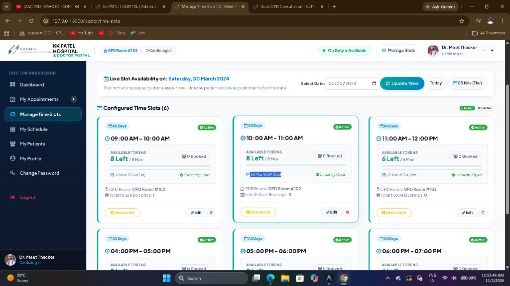
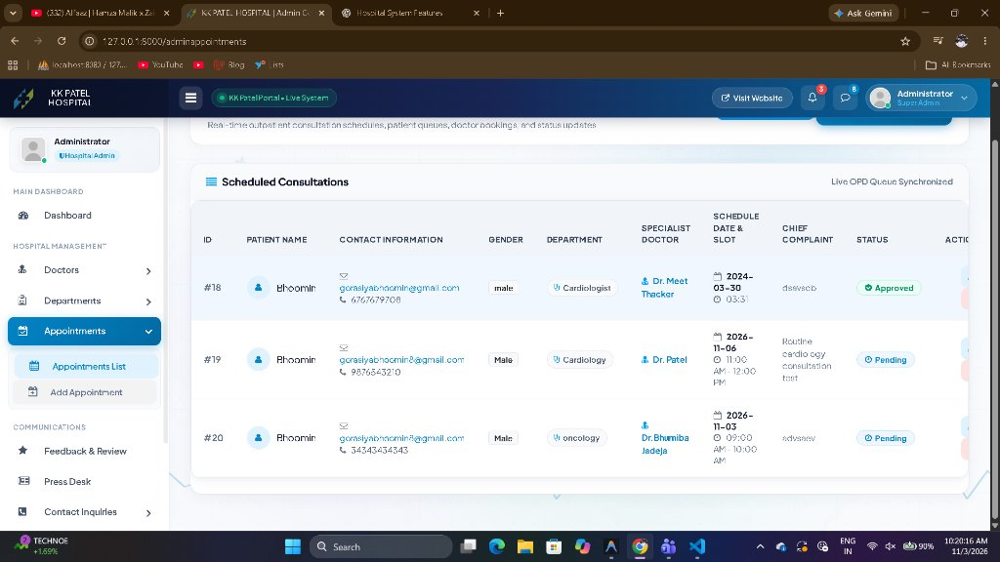
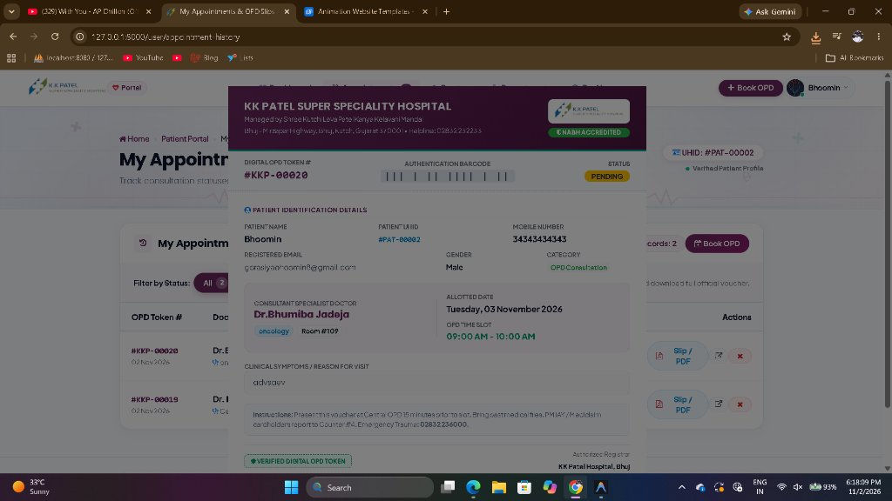
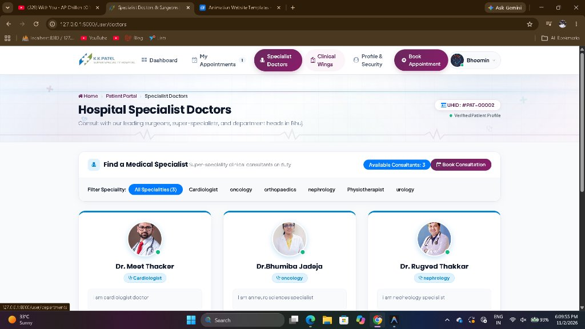
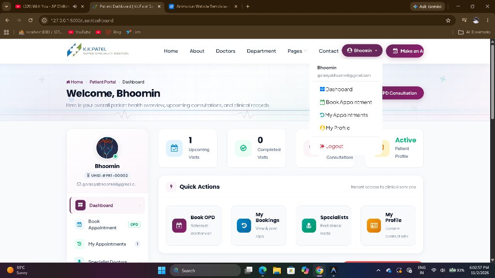

```{r setup, include=FALSE}
knitr::opts_chunk$set(echo = TRUE)
```

<p align="center">
  
</p>

# 🏥 KK Patel Super Speciality Hospital Management System

An enterprise-grade, multi-role hospital management and outpatient clinical consultation platform built with **Laravel**, **MySQL**, **Blade**, and **Bootstrap**.

## 📌 System Architecture & Portals

1. **Patient Portal**: UHID `#PAT-XXXXX` management, dynamic doctor slot booking, 30-day monthly advance window restriction, passed-time blocker, printable digital OPD token slip vouchers with barcode.
2. **Doctor Clinical Console (`/doctor/dashboard`)**: Dedicated doctor guard authentication, live patient consultation queue, dynamic time slot capacity tracker with real-time decrement (`7 Left / 8 Max`), weekly shift planner, and patient history transcripts.
3. **Super Admin Management Console**: Synchronized live consultation queue, 1-click status changers, doctor onboarding with portal passwords, department allocation, and inquiries audit.
4. **Public Hospital Website**: Emergency helpline, NABH accreditation, cashless PMJAY desk, doctor profiles, and public OPD booking.

## 📸 Screenshots

- **Doctor Panel - Manage Time Slots & Live Capacity Tracker**:
  

- **Admin Command Center - OPD Queue**:
  

- **Digital OPD Token Slip / Printable Voucher**:
  

- **Specialist Doctors Directory**:
  

- **Patient Portal Dashboard**:
  

## 🚀 Quick Setup

```bash
composer install
cp .env.example .env
php artisan key:generate
php artisan migrate
php artisan serve
```

