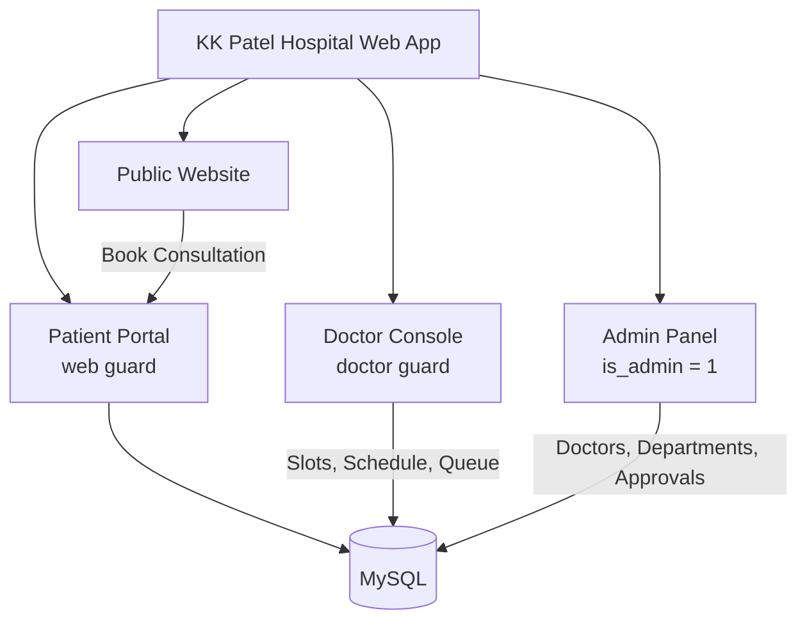
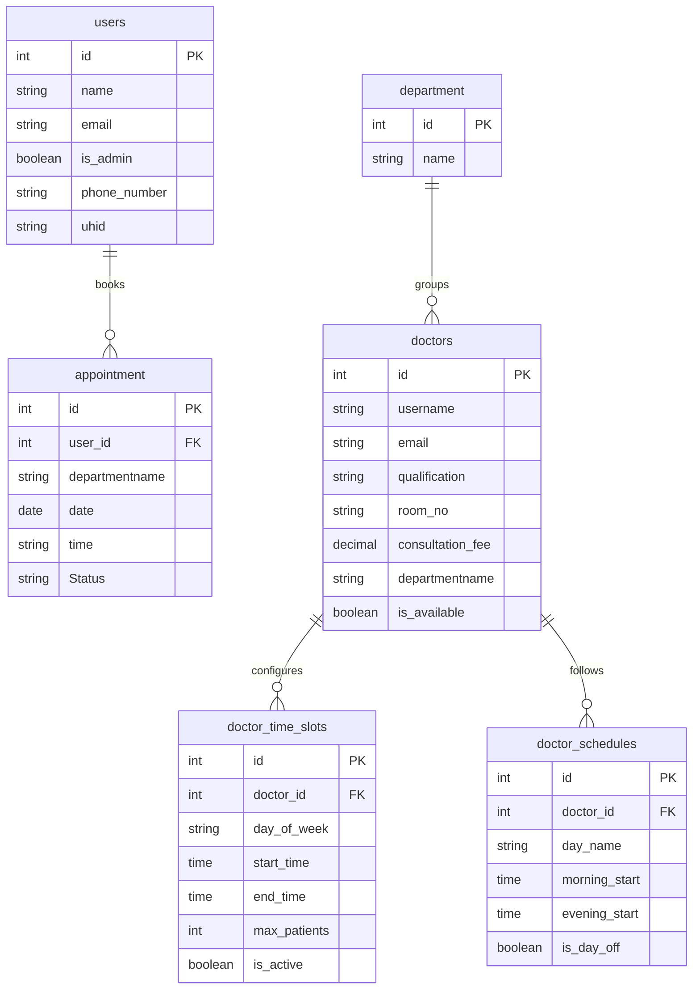

<p align="center">
  
</p>

<h1 align="center">🏥 KK Patel Super Speciality Hospital<br>Management System</h1>

<p align="center">
  <strong>A multi-role hospital management and OPD consultation platform for patients, doctors and administrators.</strong><br>
  Built with Laravel, MySQL, Blade and Bootstrap.
</p>

<p align="center">
  
  
  
  
  
  
</p>

<p align="center">
  <a href="#-features">Features</a> •
  <a href="#-screenshots">Screenshots</a> •
  <a href="#-quick-start">Quick Start</a> •
  <a href="#-demo-accounts">Demo Accounts</a> •
  <a href="#-roadmap">Roadmap</a>
</p>

---

## 📌 Table of Contents

- [Overview](#-overview)
- [Features](#-features)
- [System Architecture](#-system-architecture)
- [Screenshots](#-screenshots)
- [Tech Stack](#-tech-stack)
- [Database Schema](#-database-schema)
- [Quick Start](#-quick-start)
- [Demo Accounts](#-demo-accounts)
- [Security Notes](#-security-notes)
- [Project Structure](#-project-structure)
- [Roadmap](#-roadmap)
- [Contributing](#-contributing)
- [License](#-license)

---

## 🏥 Overview

**KK Patel Super Speciality Hospital** (Bhuj, Kutch, Gujarat) is a modern web platform that streamlines outpatient care (OPD): appointment booking, doctor consultations, patient queues and administrative workflows.

**Highlights**

- ⏱️ Real-time slot scheduling that hides slots whose time has already passed
- 🎟️ Token vouchers with a printable digital OPD slip
- 📅 30-day advance booking window
- 👨‍⚕️ Doctor shift and capacity management with live remaining-token counts
- 🔐 Separate login guards for patients, doctors and admins

---

## ✨ Features

### 👤 Patient Portal
- **Unique UHID** for every patient (e.g. `#PAT-00002`)
- **Dynamic OPD booking**
  - Live slot loading by specialist and date
  - Elapsed slots are filtered out automatically (e.g. `10:00 AM` is hidden at `11:20 AM`)
  - Bookable from today up to 30 days ahead
  - Pick slots from a dropdown or clickable slot chips
- **Digital OPD slip**: printable and downloadable, with barcode, token number (e.g. `#KKP-00020`), room, fee and emergency helpline
- **Doctor directory** by clinical department (Cardiology, Oncology, Nephrology and more)

### 👨‍⚕️ Doctor Console
- **Dashboard**: today's queue plus KPIs (consultations, pending, approved, unique patients) and a duty-status toggle
- **Manage Time Slots (CRUD)**
  - Morning and evening OPD windows
  - Token capacity per slot, with a live counter (`7 Left / 8 Max`) and occupancy bar
  - Date selector for upcoming bookings
- **My Schedule**: 7-day weekly planner with morning/evening shifts and rest days
- **My Patients**: searchable directory with visit history and symptoms
- **Profile**: qualifications, room number, OPD fee and biography

### 🛡️ Admin Command Center
- **Doctor onboarding** with hashed portal credentials and auto-seeded default time slots and weekly schedule
- **Live consultation queue** with one-click status changes: `Approved` · `Pending` · `Completed` · `Cancelled`
- **Department management** for wings and sub-specialities
- **Press desk** for press releases, news bulletins and patient feedback review

### 🌐 Public Website
- Responsive landing page covering super-specialities, NABH accreditation, emergency trauma desk (`02832-236000`), PMJAY cashless desk and direct booking

---

## 🧭 System Architecture



| Role | Table | Guard | Entry point |
|---|---|---|---|
| Patient | `users` | `web` | `/user/login` |
| Doctor | `doctors` | `doctor` | `/doctor/login` |
| Super Admin | `users` (`is_admin = 1`) | `web` | `/adminappointments` |

---

## 📸 Screenshots

| Doctor: Time Slots & Live Capacity | Admin: Live OPD Queue |
|:---:|:---:|
|  |  |

| Digital OPD Slip | Specialist Directory |
|:---:|:---:|
|  |  |

<p align="center">
  <b>Patient Dashboard</b><br>
  
</p>

---

## 🛠 Tech Stack

| Layer | Technology |
|---|---|
| Backend | Laravel 9.x / 10.x (PHP 8.0+) |
| Database | MySQL 8.0 with Eloquent ORM |
| Frontend | Blade, Bootstrap 4/5, jQuery, HTML5, CSS3 |
| Icons | FontAwesome 4.7 / 5, custom medical SVGs |
| Date/Time | Carbon, synchronized to `Asia/Kolkata` (IST) |
| Server | Apache / Nginx (Laragon, XAMPP, WAMP compatible) |

---

## 🗄 Database Schema



---

## 🚀 Quick Start

### Prerequisites
- PHP ≥ 8.0 and Composer
- MySQL 5.7+ / 8.0
- Laragon, XAMPP or WAMP (optional)

### Installation

```bash
# 1. Clone
git clone https://github.com/<your-username>/hospitalwebsite.git
cd hospitalwebsite

# 2. Install dependencies
composer install

# 3. Configure environment
cp .env.example .env
php artisan key:generate
```

Edit `.env` with your database details:

```env
APP_NAME="KK Patel Hospital"
APP_ENV=local
APP_DEBUG=true
APP_URL=http://127.0.0.1:8000
APP_TIMEZONE=Asia/Kolkata

DB_CONNECTION=mysql
DB_HOST=127.0.0.1
DB_PORT=3306
DB_DATABASE=hospital
DB_USERNAME=root
DB_PASSWORD=
```

```bash
# 4. Create the database, then migrate
php artisan migrate

# 5. Clear caches and run
php artisan optimize:clear
php artisan serve
```

Open **http://127.0.0.1:8000** 🎉

---

## 🔑 Demo Accounts

> ⚠️ **For local development only.** Change or remove these before any public deployment.

### Doctor Panel: `/doctor/login`

| Doctor | Department | Email | Password |
|---|---|---|---|
| Dr. Meet Thacker | Cardiology | `meetthacker@gmail.com` | `doctor123` |
| Dr. Bhumiba Jadeja | Oncology | `bhumibajadeja@gmail.com` | `doctor123` |
| Dr. Rugved Thakkar | Nephrology | `rugvedthakkar@gmail.com` | `doctor123` |

### Patient Portal: `/user/login`
Register a new account from the sign-up page.

### Super Admin: `/adminappointments`
Create an admin by setting `is_admin = 1` on a user:

```bash
php artisan tinker
>>> \App\Models\User::where('email', 'you@example.com')->update(['is_admin' => 1]);
```

---

## 🔒 Security Notes

- Never commit your `.env` file or real credentials
- Set `APP_DEBUG=false` and `APP_ENV=production` in production
- Change all default doctor passwords (`doctor123`) after first login
- Keep real patient data out of the repository and screenshots
- Serve over HTTPS and keep Laravel and dependencies updated (`composer update`)

---

## 📁 Project Structure

```text
hospitalwebsite/
├── app/
│   ├── Http/Controllers/    # Patient, Doctor and Admin controllers
│   └── Models/              # User, Doctor, Appointment, DoctorTimeSlot ...
├── database/migrations/
├── resources/views/         # Blade templates (public, user, doctor, admin)
├── routes/web.php
├── public/img/              # Logo and static assets
└── docs/screenshots/        # README images
```

---

## 🗺 Roadmap

- [ ] SMS / WhatsApp appointment reminders
- [ ] Online payment for consultation fees
- [ ] Lab reports and prescription uploads
- [ ] Gujarati / Hindi language support
- [ ] Automated tests (PHPUnit / Pest) and CI via GitHub Actions
- [ ] REST API and mobile app

---

## 🤝 Contributing

Contributions are welcome!

1. Fork the repository
2. Create a branch: `git checkout -b feature/your-feature`
3. Commit: `git commit -m "Add your feature"`
4. Push: `git push origin feature/your-feature`
5. Open a Pull Request

---

## 📄 License

Released under the **MIT License**.

Developed for **KK Patel Super Speciality Hospital**, managed by Shree Kutchi Leva Patel Kanya Kelavani Mandal, Bhuj, Gujarat.

<p align="center">
  <sub>Built with ❤️ for accessible and reliable healthcare.</sub>
</p>
