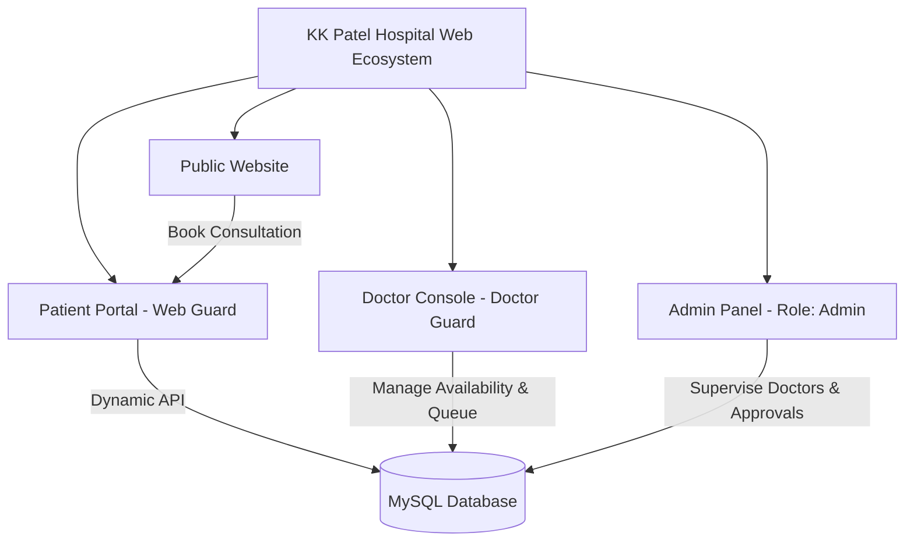
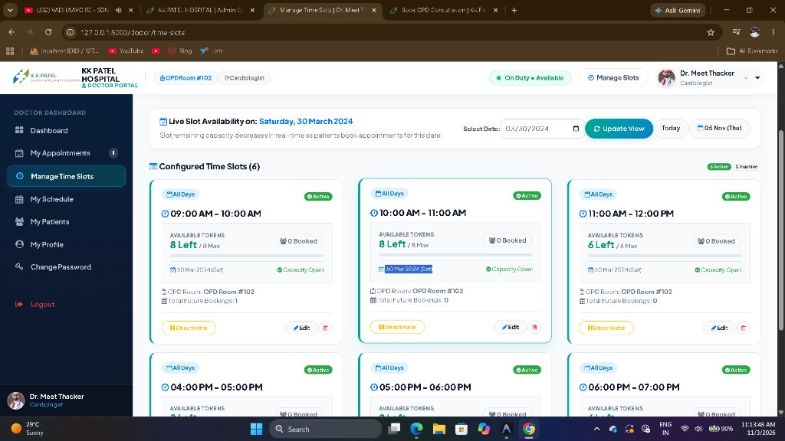
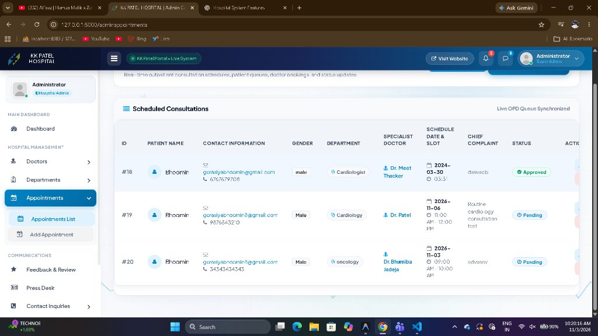
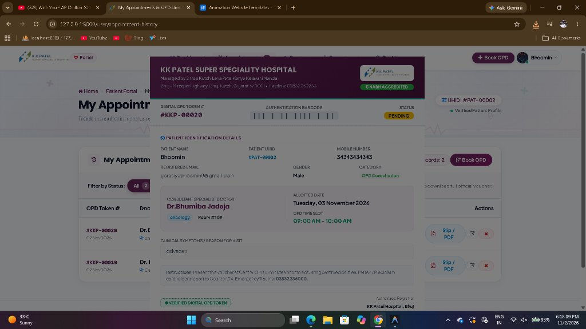
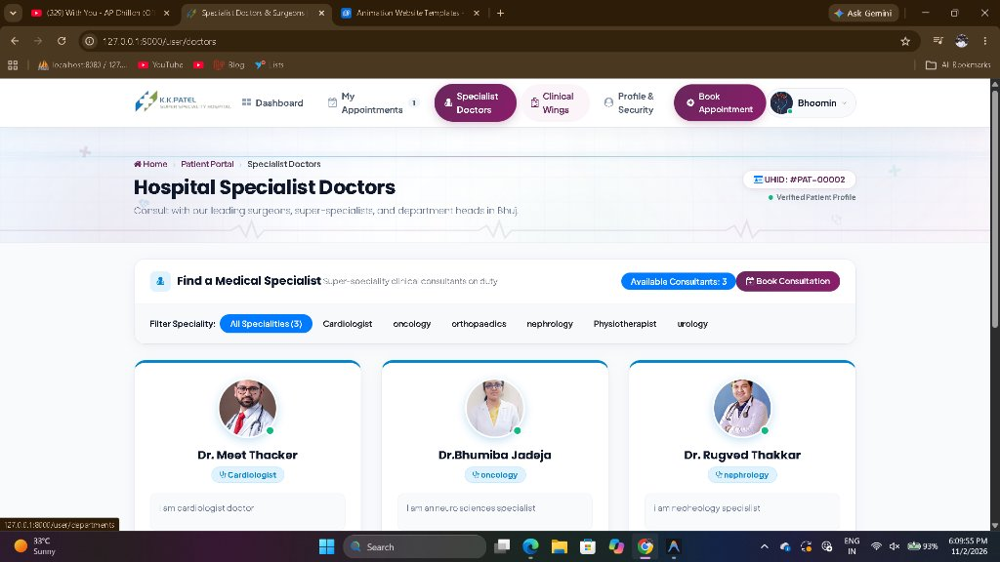
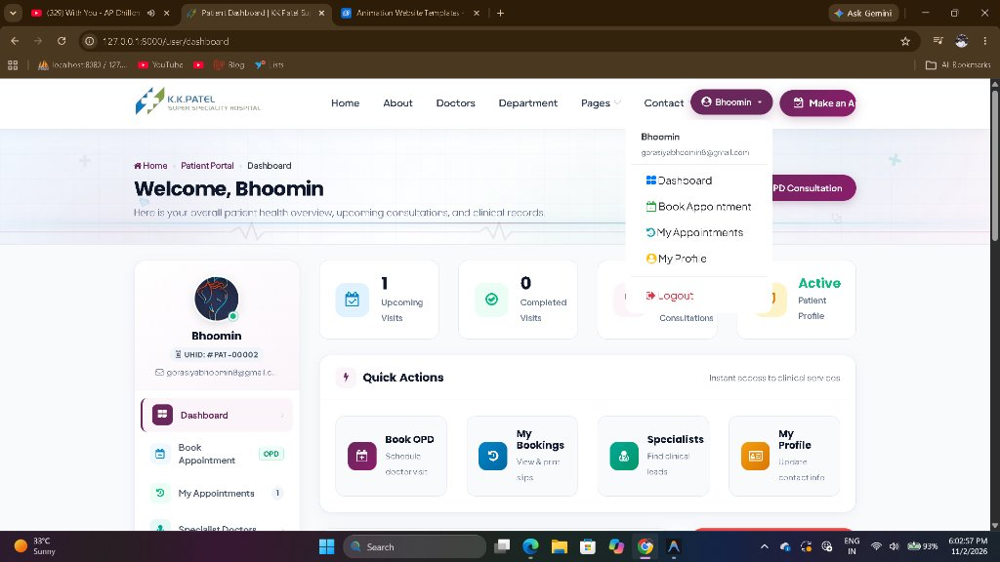

<p align="center">
  
</p>

<h1 align="center">🏥 KK Patel Super Speciality Hospital Management System</h1>

<p align="center">
  <strong>An enterprise-grade, multi-role hospital management and outpatient clinical consultation platform.</strong><br>
  Built with <strong>Laravel</strong>, <strong>MySQL</strong>, <strong>Blade</strong>, and <strong>Bootstrap</strong>.
</p>

<p align="center">
  
  
  
  
  
  
</p>

---

## 📌 Table of Contents

- [Overview](#-overview)
- [System Architecture & Roles](#-system-architecture--roles)
- [Key Features](#-key-features)
  - [1. Patient Portal](#1-patient-portal)
  - [2. Doctor Clinical Console](#2-doctor-clinical-console)
  - [3. Super Admin Command Center](#3-super-admin-command-center)
  - [4. Public Hospital Portal](#4-public-hospital-portal)
- [Screenshots & Visual Tour](#-screenshots--visual-tour)
- [Tech Stack](#-tech-stack)
- [Database Schema & Models](#-database-schema--models)
- [Installation & Local Setup](#-installation--local-setup)
- [Default Login Credentials](#-default-login-credentials)
- [Contributing & License](#-contributing--license)

---

## 🏥 Overview

**KK Patel Super Speciality Hospital** (Bhuj, Kutch, Gujarat) is a modern healthcare management system designed to streamline outpatient care (OPD), doctor consultations, patient queues, and clinical administrative workflows.

The system features real-time dynamic time slot scheduling, token voucher generation with printable slips, doctor shift management, and strict appointment availability controls (such as 30-day monthly booking caps and real-time expiration of past consultation slots).

---

## 👥 System Architecture & Roles

The system uses a **multi-guard architecture** to provide dedicated interfaces for each stakeholder:



1. **Patients (`users` table, `web` guard)**: Register, view health records, schedule OPD visits, track token status, and download digital OPD slips.
2. **Doctors (`doctors` table, `doctor` guard)**: Dedicated clinical login (`/doctor/login`), manage consultation time slots, view today's patient queue, track patient histories, and configure weekly shift schedules.
3. **Super Administrators (`users` table, `is_admin = 1`)**: Onboard doctors with hashed portal credentials, manage hospital departments, audit consultations, and supervise operations.

---

## ✨ Key Features

### 1. Patient Portal
- **Unique Patient Identifier (UHID)**: Every patient receives an official hospital UHID (e.g. `#PAT-00002`).
- **Dynamic OPD Appointment Booking**:
  - Live doctor slot fetching based on specialist and selected consultation date.
  - **Passed-Time Filter**: Time slots that have already ended today (e.g., `10:00 AM` when the clock is `11:20 AM`) are automatically filtered out.
  - **30-Day Monthly Advance Window**: Restricts booking between Today and 30 days ahead according to the monthly schedule.
  - **Interactive Slot Chips**: Patients can choose time slots via dropdown or quick clickable pills.
- **Digital Verified OPD Slip**:
  - Downloadable and printable clinical voucher.
  - Contains verification barcode, Token # (e.g. `#KKP-00020`), allotted room, consultation fees, and emergency helpline.
- **Doctor Directory & Clinical Wings**: Explore specialist doctors by clinical departments (Cardiology, Oncology, Nephrology, etc.).

### 2. Doctor Clinical Console
- **Clinical Dashboard**:
  - Live patient roster for Today's OPD queue.
  - Real-time KPI metrics: Today's consultations, pending visits, approved treatments, and unique patient reach.
  - Active shift schedule and duty status toggle.
- **Manage Time Slots (CRUD)**:
  - Create and configure morning and evening OPD consultation windows.
  - Customize token capacity per slot (e.g., maximum 8 patients).
  - **Live Remaining Capacity Decrement**: Shows real-time available tokens (e.g., `7 Left / 8 Max`) and booked counts with an occupancy progress bar.
  - **Date Selector**: Filter availability across upcoming dates with active patient bookings.
- **My Schedule**: 7-day weekly schedule planner (Monday through Sunday) with morning/evening shifts and rest day markers.
- **My Patients**: Searchable patient directory with historical visit transcripts and symptoms.
- **Doctor Profile**: Manage qualifications, room numbers, OPD fees, biography, and credentials.

### 3. Super Admin Command Center
- **Doctor Onboarding**: Form to add doctors with portal passwords, automated credential hashing, and automatic seeding of default time slots and 7-day shift schedules.
- **Live Consultation Queue**: Spacious 6-column appointment table with 1-click status dropdowns (`Approved`, `Pending`, `Completed`, `Cancelled`).
- **Department Management**: Add and maintain medical departments and sub-specialties.
- **Press Desk & Communications**: Publish press releases, news bulletins, and review patient feedback.

### 4. Public Hospital Portal
- Responsive landing page showcasing hospital super-specialities, NABH accreditation, emergency trauma desk (02832-236000), PMJAY cashless desk, and direct booking integration.

---

## 📸 Screenshots & Visual Tour

### 1. Doctor Panel - Manage Time Slots & Real-Time Capacity Tracker
*Shows live decreasing capacity (`7 Left / 8 Max`), booked patient badges, and date selector.*
<p align="center">
  
</p>

---

### 2. Admin Command Center - Synchronized Live OPD Queue
*Live outpatient appointment monitoring with 1-click status changers and search tabs.*
<p align="center">
  
</p>

---

### 3. Digital OPD Token Slip / Printable Consultation Voucher
*Official token voucher with hospital accreditation, barcode, assigned specialist, and triage guidelines.*
<p align="center">
  
</p>

---

### 4. Patient Portal - Specialist Doctors Directory
*Browse clinical department heads and leading surgeons with real-time duty status.*
<p align="center">
  
</p>

---

### 5. Patient Portal Dashboard
*Command overview showing upcoming consultations, digital records, and quick patient actions.*
<p align="center">
  
</p>

---

## 🛠 Tech Stack

- **Backend Framework**: [Laravel 9.x / 10.x](https://laravel.com/) (PHP 8.0+)
- **Database**: [MySQL 8.0](https://www.mysql.com/) with Eloquent ORM
- **Frontend / Templating**: Blade Templates, Bootstrap 4/5, jQuery, HTML5, CSS3
- **Icons & UI**: FontAwesome 4.7 / 5, Custom Medical SVG Icons
- **Date & Time Management**: Carbon with `Asia/Kolkata` Indian Standard Time synchronization
- **Web Server**: Apache / Nginx (Laragon / XAMPP compatible)

---

## 🗄 Database Schema & Models

- `users`: Patient and admin accounts (`id`, `name`, `email`, `password`, `is_admin`, `phone_number`, `uhid`, `created_at`, `updated_at`).
- `doctors`: Clinical specialist profiles (`id`, `username`, `email`, `password`, `qualification`, `room_no`, `consultation_fee`, `departmentname`, `is_available`, etc.).
- `doctor_time_slots`: Configured consultation windows (`id`, `doctor_id`, `day_of_week`, `start_time`, `end_time`, `slot_display`, `max_patients`, `is_active`).
- `doctor_schedules`: Weekly recurring duty roster (`id`, `doctor_id`, `day_name`, `morning_start`, `morning_end`, `evening_start`, `evening_end`, `is_day_off`).
- `appointment`: Booked consultations (`id`, `user_id`, `appointmentname`, `email`, `phone`, `gender`, `departmentname`, `username`, `date`, `day`, `time`, `message`, `Status`).
- `department`: Medical department wings.

---

## 🚀 Installation & Local Setup

Follow these steps to run the project locally on your machine:

### 1. Prerequisites
- **PHP** >= 8.0
- **Composer**
- **MySQL** >= 5.7 or 8.0
- **Laragon** / **XAMPP** / **WAMP**

### 2. Clone the Repository
```bash
git clone https://github.com/your-username/hospitalwebsite.git
cd hospitalwebsite
```

### 3. Install Composer Dependencies
```bash
composer install
```

### 4. Configure Environment Variables
Copy `.env.example` to `.env` and set your local database credentials:
```bash
cp .env.example .env
```
Ensure your `.env` contains:
```env
APP_NAME="KK Patel Hospital"
APP_ENV=local
APP_KEY=
APP_DEBUG=true
APP_URL=http://127.0.0.1:8000
APP_TIMEZONE=Asia/Kolkata

DB_CONNECTION=mysql
DB_HOST=127.0.0.1
DB_PORT=3306
DB_DATABASE=hospital
DB_USERNAME=root
DB_PASSWORD=
```

### 5. Generate Application Key
```bash
php artisan key:generate
```

### 6. Run Database Migrations
```bash
php artisan migrate
```

### 7. Clear & Cache Configurations
```bash
php artisan optimize:clear
```

### 8. Start the Development Server
```bash
php artisan serve
```
Visit the website at: **`http://127.0.0.1:8000`**

---

## 🔑 Default Login Credentials

### 👨‍⚕️ Doctor Panel (`http://127.0.0.1:8000/doctor/login`)
| Doctor Name | Department | Email | Initial Password |
|---|---|---|---|
| **Dr. Meet Thacker** | Cardiology | `meetthacker@gmail.com` | `doctor123` |
| **Dr. Bhumiba Jadeja** | Oncology | `bhumibajadeja@ggmail.com` | `doctor123` |
| **Dr. Rugved Thakkar** | Nephrology | `rugvedthakkar@gmail.com` | `doctor123` |

### 👤 Patient Portal (`http://127.0.0.1:8000/user/login`)
- Email: `gorasiyabhoomin8@gmail.com`
- Password: *(your registered patient account password)*

### 🛡 Super Admin (`http://127.0.0.1:8000/adminappointments`)
- Access through admin credentials or the admin navigation menu.

---

## 📄 License & Attribution

This project is licensed under the **MIT License**.  
Developed for **KK Patel Super Speciality Hospital**, managed by Shree Kutchi Leva Patel Kanya Kelavani Mandal, Bhuj, Gujarat.

<p align="center">
  <sub>Built with ❤️ for accessible and reliable healthcare management.</sub>
</p>
